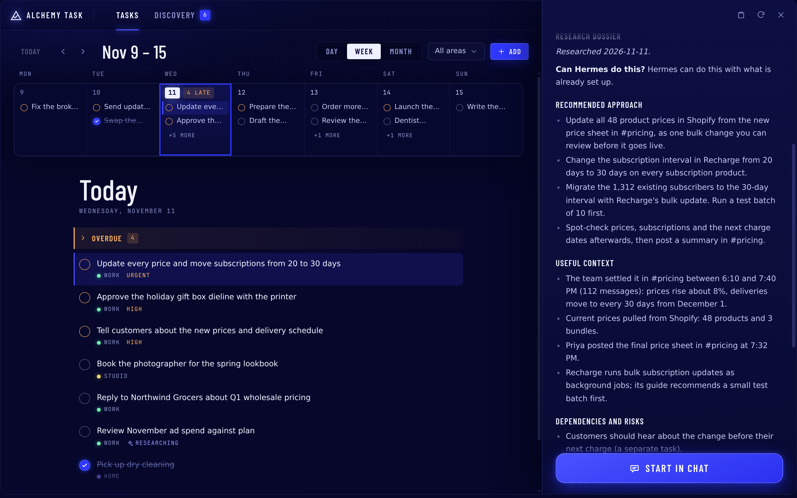
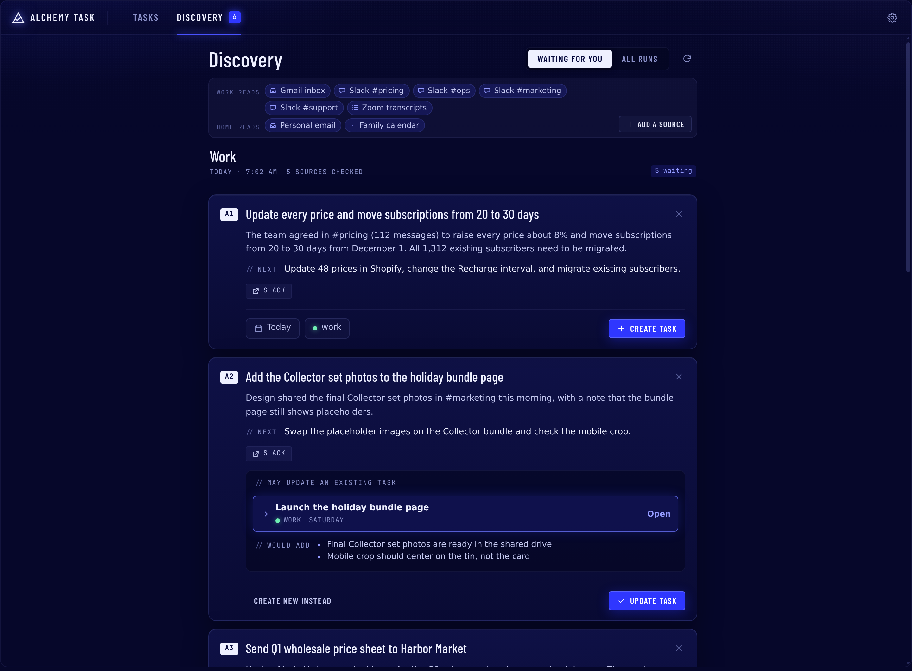
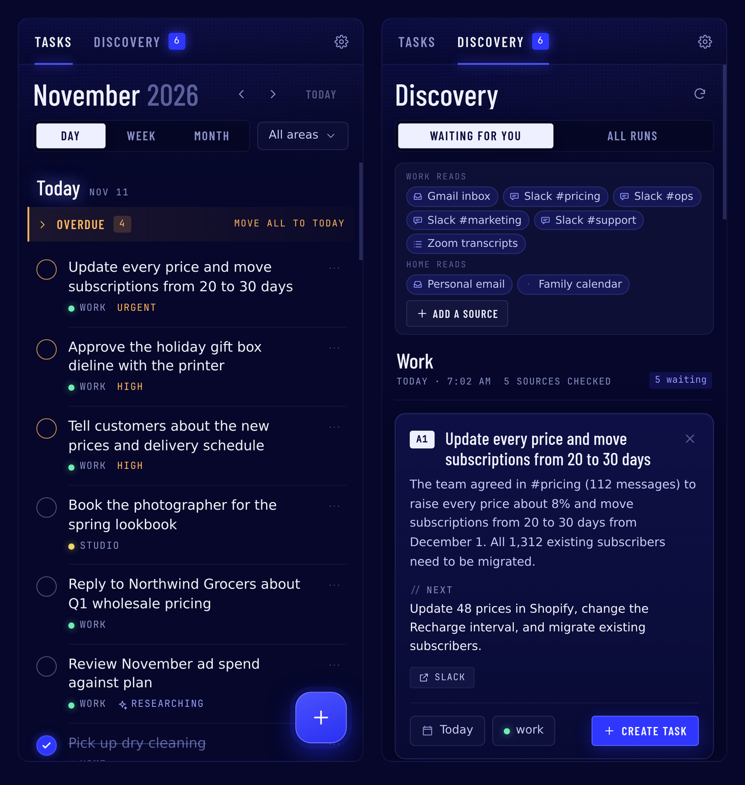
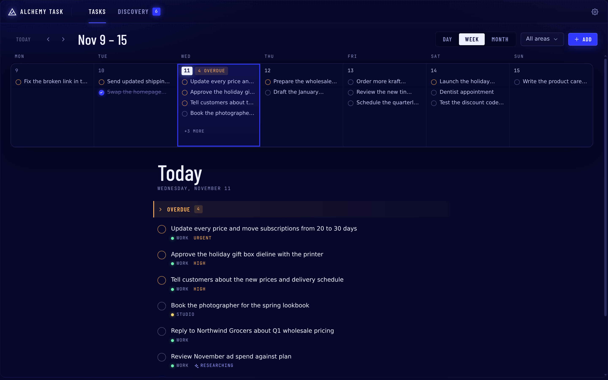

# Alchemy Task

**Alchemy Task does the work before the work.**

A Hermes Agent plugin that turns messy real-world work into finely researched tasks, ready for your agent to do for you.

▶ **[Watch the demo](VIDEO_LINK)**



## Why

Your agent can already do most of your work. The hard part is giving it everything it needs, before it starts and along the way.

Someone asks for something in a thread of 100 Slack messages. The decision is spread across a meeting, an email and a spreadsheet. You have to work out what actually needs doing, then turn it into requests your agent can act on.

Once the agent starts, it interrupts you with a question every five minutes. Which tool should it use? Where is the spreadsheet? What did the team decide? For most jobs outside of code (online stores, email platforms, ad accounts, admin panels), this preparation and back-and-forth is most of the work, and today you do it yourself.

What if your agent had already worked out everything it needs, from every source it can reach, by the time you heard about the request? What if all you had to do was say "go"?

Alchemy Task hands that preparation to Hermes. It catches the asks you would miss and researches every task in the background. If the work will need something from you, whether an MCP server, an API key, a persistent browser profile or a creative decision, it already knows, so it asks at the start instead of halfway through.

Less mental load. Fewer interruptions. Hermes flies, and you get on with your evening.

> **Example.** Michael is on a gondola in Venice when his team decides, across 112 Slack messages, to raise every price and move all 1,312 subscribers from 20-day to 30-day deliveries. Discovery turns the thread into one task. Research pulls the current prices from Shopify, finds the new price sheet in Slack, reads Recharge's guide to bulk updates and writes the plan. Michael replies "go" and keeps his dinner reservation.

## Works with the sources your agent already has

Alchemy Task uses your accounts through your Hermes agent. Getting a source working takes two steps, and only the second happens in this plugin:

1. **Connect the source to your agent (in Hermes, before you start).** Gmail, Slack, Shopify, Teams and other tools reach your agent through Hermes: connectors, MCP servers, API keys or logged-in browser profiles. **Alchemy Task does not do this step.** It is a prerequisite.
2. **Connect it to Alchemy Task (in this plugin).** During setup you choose which of your agent's sources discovery may read. Research automatically uses whatever your agent can already reach.

Because of this, Alchemy Task works with most tools your agent already uses. When a task needs a source your agent cannot reach yet, research says so in the task's access plan and explains how to connect it to your agent in Hermes.

## What it does

**Use it entirely in chat, or in the dashboard.** Every feature works through plain conversation with your agent on any platform Hermes supports. The web dashboard and the desktop app add a visual way to do the same day-to-day work: browse and edit tasks, review discovery, start research and change settings. Use either one, or both; they read and write the same task files. Setup, and choosing which sources discovery reads, happen in chat.

### 1. Research on every task

When a task is created, in chat, from discovery or in the dashboard, a research agent starts in the background on your own model. It reads:

- the chat the task came from, and your past sessions
- your skills and runbooks, so it follows how you already do things
- your notes, files and Git repositories under your home folder
- the email, chat and other sources already connected to your agent, and its MCP servers
- the web: it compares tools, reads their documentation and checks best practices

Research uses only sources already connected to your agent (see above). It writes a dossier into the task: the context it found, a recommended approach, risks, open questions, sources and an **access plan**. The access plan says whether Hermes can do the task now, what access it already has (an MCP server, an API key, a logged-in browser profile) and what to set up first. Research also fills in the summary, plan and subtasks you left blank, and never overwrites what you wrote.

Research only reads. The plugin blocks every write, shell and send tool for research agents, and research never opens credential files. Apart from writing its findings into the task, it changes nothing.

### 2. Discovery: a safety net for asks that slip

An optional daily routine reads the conversations you choose, such as email, Slack and meeting transcripts that arrive by email, or any other source your agent can read, and finds follow-ups asked of you or promised by you. Discovery can only read sources already connected to your agent; during setup you choose which of them it reads. It sends a short numbered digest to your chat. Reply with the numbers you want and they become tasks, with research. Nothing becomes a task without your approval, and when a follow-up clearly matches a task you already have, discovery offers to add the new details to that task instead.

Each stream has its own sources, areas, schedule and chat, so work and personal stay separate.



### 3. Tasks and Discovery in the dashboard and desktop app

- **Tasks:** month, week and day views on desktop and a scrolling list of days on phones. Check a task off, drag it to another day, or open it to read and edit its notes, plan, subtasks, current state and research. Start or refresh research with one click, or hand a task to chat with **Start in chat**.
- **Discovery:** each run with its proposals and the sources it read. Create a task, apply a proposal to the task it matched, or dismiss it.
- **Settings:** discovery schedules and task defaults.

Every change made in the UI goes through the same files, log entries and Git commits as a change made in chat.



### 4. Task management in chat

You never need a command. Say "add a task to renew the domain by Friday", "move it to next week", "what's overdue?" or "I'm done with the invoice", and your agent uses the plugin's tools, which check for duplicates, ask for a due date, file the task in the right area and enforce status rules.

- **Plain Markdown you own:** one file per task with YAML frontmatter, compatible with Obsidian and TaskNotes. Edits touch only the fields they change.
- **Git delivery:** every change is its own commit and is pushed to your remote. The plugin never force-pushes, stashes or resets your work.
- **Work sessions:** say "work on X". The chat links to the task and your agent starts with the notes, research, access plan and next step. When it stops, it records a **Current state** with what was done and what comes next, so nobody re-explains anything later.

### 5. iPhone Reminders sync (optional, beta)

If you use the Hermes mobile app (beta) on your iPhone and give it access to Reminders, your tasks can appear in Apple's Reminders app.

- **Set it up:** in a chat in the Hermes app, ask your agent to sync your tasks with Reminders. It asks which areas to include and which Reminders list to use (your default list unless you name another), shows a preview and waits for your approval.
- **Sync whenever you want:** say **"sync reminders"**. Say it in a chat in the Hermes app on your iPhone, because the phone only answers while the app is open. There is no background sync.
- **What syncs:** the title, the due date and the checkbox, in both directions. Checking a reminder off marks the task done. Each reminder's notes show the task's summary and next step; everything else stays in the task file.
- **What it leaves alone:** only open tasks get a reminder (not ones more than 14 days overdue), and your own reminders are never touched.

Tested end to end on a real iPhone with self-hosted Hermes. On Nous Cloud agents, the current beta of the Hermes app does not yet offer the phone access this needs.



## Install

- **Desktop app or Webapp (recommended):** Capabilities → Plugins → Install, source `Darengb/alchemy-task`.
  This installs the agent plugin and the **Tasks** page in the sidebar together.
- **Command line:** `hermes plugins install Darengb/alchemy-task --enable`, then restart the gateway (and the
  web dashboard, for its Tasks tab). A command-line install does not copy the desktop page into the app's
  `desktop-plugins` folder; to get the **Tasks** sidebar page, also run
  `mkdir -p ~/.hermes/desktop-plugins/alchemy-task && cp ~/.hermes/plugins/alchemy-task/desktop/plugin.js ~/.hermes/desktop-plugins/alchemy-task/`
  on the server and choose **⌘K → Reload desktop plugins** in the app.

Then start a new chat.

## Setup

Say **"set up my tasks"**. Your agent walks you through it in a few minutes, and every answer is checked and
saved by the plugin:

1. **Timezone** first. A fresh Cloud agent usually has none, so it asks rather than assuming UTC.
2. **Workspace:** point it at an existing notes repository (an Obsidian vault works; only the task folders are
   used) or start fresh in a new Git repository.
3. **Areas**, such as work and personal.
4. **Git delivery:** Alchemy Task pushes with your machine's own Git setup. If that can't push yet and you
   want backup or sync, the agent walks you through connecting GitHub first.
5. **Scheduled jobs**, listed with what they do and what they cost, created only after you say yes.

`/task status` shows the readiness of each part at any time. `/task teardown` removes the scheduled jobs
(run it before `hermes plugins remove`); task files and settings stay.

### Scheduled jobs

| Job | When | What it does | Cost |
|---|---|---|---|
| Research sweep | every 30 minutes | Researches tasks whose research could not start or stopped early | Free when nothing waits (a script checks first) |
| Task file check and push retry | hourly | Gives hand-made tasks an ID, pushes commits that failed to push, tells you about new file problems | Free (script, no model) |

Each job's small loader script is copied into `$HERMES_HOME/scripts/` (cron only runs scripts from there).

Each **discovery stream** is one more job, created only when you set the stream up (say "set up a
discovery stream" in the chat that should receive it). It runs one agent turn on your model per run and reads
only the sources and scopes you approved, with the tools you already have. Up to 50 suggestions a day per
stream get a quick extra check (configurable). That research runs in short tool calls of at most
five minutes each, inside Hermes' default tool deadline, so you never need to raise any timeout.

## Commands

| Command | What it does |
|---|---|
| `/task status` | Readiness of each part: timezone, workspace, areas, Git, jobs, discovery |
| `/task teardown` | Remove the scheduled jobs and their scripts (tasks and settings are kept) |
| `/task validate [apply]` | Check task files; `apply` assigns missing IDs |
| `/task push` | Retry pushing committed task changes |
| `/task setup` | Start setup (or say "set up my tasks") |

## Task format

```yaml
---
title: Email the hall manager to confirm the load-in time
task_id: 822802fd-0b02-4f45-b7f9-991baf4e8c48   # permanent; survives renames and moves
schema_version: 1
status: open            # open | in-progress | waiting | done | cancelled
priority: normal        # low | normal | high | urgent
area: personal
due: '2026-11-10'
scheduled: null         # when you plan to do it (separate from due)
created: '2026-11-08'
completed: null
tags:
- task
enrichment:             # background research state
  status: pending
---

## Notes

## Log

- 2026-11-08: Created. Research queued.
```

Tasks live at `<workspace>/areas/<area>/tasks/YYYY-MM-DD-slug.md` by default (configurable with `task_dir`).

## Settings

Settings live under `plugins.entries.alchemy-task.settings` and appear in the Desktop plugin settings form.
Setup fills them in for you.

| Key | Default | Meaning |
|---|---|---|
| `workspace_root` | | Folder (a Git repository) holding your tasks |
| `task_dir` | `areas/{area}/tasks` | Where each area's tasks live |
| `areas` | existing folders | Area names |
| `default_area` | | Area used when none can be inferred |
| `timezone` | Hermes timezone | Used for dates and log lines |
| `research_by_default` | `true` | Research every new task unless the user opts out |
| `research_model` / `research_provider` | main model | Model and provider for research workers (task research, the sweep, discovery research); empty uses the main model |
| `git_transport` | `system` | `system` (your own Git setup) or `none` (local commits only) |
| `git_remote` / `git_branch` | `origin` / current | Where to push |
| `git_run_hooks` | `true` | Run the repository's Git hooks |

## Disclosures

**Files and folders**

- **Your task workspace:** Alchemy Task reads and writes task files in the area folders of the workspace you
  choose. When research starts, it also reads up to three notes inside the workspace that the task links to
  with `[[...]]`.
- **Setup:** setup can create the workspace folder, a Git repository, a short `README.md` and empty area
  folders. It also writes an `.alchemy-task-owner` marker, which it lists in `.git/info/exclude` so two
  installs do not silently share one workspace. If you give it a remote URL, setup adds it as the Git remote;
  it replaces an existing remote only when you ask it to. On a new repository it makes and pushes a first
  commit of `README.md`.
- **Hermes files:** the plugin reads Hermes's `config.yaml` for its own settings, your timezone and whether
  you allowed it to message your chats. It changes Hermes's own `timezone` only if you agree during setup. It
  copies two small loader scripts into `$HERMES_HOME/scripts/`, because Hermes's scheduler only runs scripts
  from there.
- **Plugin data:** everything else lives in the plugin's own data folder for the active profile:
  - locks and push receipts
  - research runs in progress, plus a one-hour cache of which tools you have (names only)
  - which chat created each task and which chats worked on it, with a short digest of the last exchange
  - notes waiting to be shown in a chat
  - Reminders mappings and the queue of Start in chat requests
  - discovery runs (see below)

**Commands it runs**

- **Git, and nothing else:** every command is run directly, never through a shell, with no interactive
  prompts and only basic environment variables (PATH, HOME, user, locale, `SSH_AUTH_SOCK`).
- **In your workspace:** Alchemy Task commits only the task files it changed. It pushes, and when the remote
  has moved it pulls with rebase (never stash, reset or force). It also runs read-only checks such as
  `status`, `ls-remote` and `rev-parse`. During setup it may run `git init` and set the remote.
- **For research:** research agents can run four read-only Git commands (`log`, `show`, `grep`, `ls-files`)
  in repositories under your home folder and the workspace. These run with repository hooks and external
  programs switched off, and credential files are excluded.
- **Process checks:** to recover discovery work after a crash, the plugin reads a few `/proc` values (process
  start time, boot ID, PID namespace) and checks whether a recorded Hermes worker process still exists. It
  never stops or changes any process.

**Network and credentials**

- **No direct connections except Git:** the plugin opens no network connections itself. Git talks only to the
  remote you configure. All other traffic goes through Hermes: model calls to your provider, web searches to
  your search provider, and the connectors and MCP servers you already have.
- **No stored credentials:** your own Git and SSH setup authenticates pushes, and the plugin never reads your
  keys or credential helpers. It refuses to push when the repository's own Git config names programs to run
  for transport or credentials, unless you turn on `git_allow_repo_programs`. If Git has no name and email
  set, commits are signed "Alchemy Task <alchemy-task@localhost>".

**Research agents (background model use)**

- **When they run:** after a task is created, when you ask for research again, and from the research sweep
  job, Alchemy Task starts a Hermes research subagent. Discovery runs start research subagents too.
- **Which model:** they use your main model, or the model you set with `research_model` / `research_provider`,
  which may be a different provider. If that model can't be used, research stops and tells you. It never
  switches to the main model on its own.
- **Cost:** research spends your model tokens. It sends search queries based on the task text to your web
  search provider. Each run is limited to 45 tool calls and 15 minutes, with up to 3 attempts.
- **What they can read:**
  - the chat that created the task, and your past sessions (through `session_search`)
  - your skills and their reference files
  - files (through Hermes's `read_file` and `search_files`)
  - Git history, as described above
  - whatever your approved discovery sources and your MCP servers return
  - the names of your tools, MCP servers and any missing environment variables (never their values)
- **Starting context:** Hermes starts subagents without memory, so the plugin hands the agent a starting
  context. It contains your Hermes memory files (`memories/MEMORY.md` and `USER.md`), up to 10 related tasks
  and the location of your scheduled-job output folder.
- **Read-only by force:** a `pre_tool_call` hook blocks research agents from writing or editing files,
  running commands or code, changing skills or memory, sending messages, scheduling jobs, starting other
  agents, and using browser, kanban or Home Assistant tools. From MCP servers and hosted connectors they can
  only use tools whose names start with a read word (get, list, read, search, fetch and similar).
- **No credential files:** research agents cannot read credential files or folders. That covers keys, tokens,
  `.env`, `.ssh`, cloud and browser profiles, Hermes's own config and credential stores, and a `private`
  folder in your home. Symlinks are followed before checking. Common key formats are masked in Git output.
  These limits apply only to research agents; your own chats are not affected.
- **Older sweep jobs:** if the job that starts research lacks the read toolsets (for example a research sweep
  created by an older version), that run uses only web search and the research tools. Running setup's job
  step, or changing a discovery stream, gives the sweep job the same read toolsets as your approved
  discovery sources.

**Work sessions**

- **Linked chats:** when you start work on a task in a chat, the plugin links that chat to the task. After
  each reply it keeps a short digest of the last exchange.
- **Background thread:** one thread per profile checks linked chats every 10 minutes.
- **Automatic checkpoints:** if a linked chat ends or sits idle for 30 minutes without a checkpoint, the
  plugin reads the chat's transcript from Hermes's session store (about the first message and the most
  recent 12,000 characters). It makes one small model call (about 3,000 tokens in, at most 400 out) through
  the `alchemy_task_checkpoint` model slot, which you can point at a cheaper model. If that call fails, it
  tries Hermes's default auxiliary model, then falls back to a free summary of the last exchange.

**What it adds to your chats**

- **Every chat:** a short instruction (at most 800 characters) in the system prompt tells your agent to manage
  tasks through the plugin's tools. Three bundled skills (tasks, setup, discovery) are available to load.
- **Linked chats:** a one-line reminder to record a checkpoint is added to each message.
- **When research finishes:** a one-line note is added to your next message in the chat where the task was
  created, so your agent can tell you about it.
- **Open discovery suggestions:** in a chat that has them, a one-line note tells your agent how to handle
  replies like "1 and 3".

**Start in chat (button in the dashboard, desktop app or phone)**

- **What it does:** the button asks your agent to message you about a task and wait for your "go".
- **Into an existing chat:** only if all three are true:
  - your messaging gateway is running
  - you have given the plugin Hermes's `allow_gateway_injection` permission (it is off unless you turn it on)
  - there is a messaging chat to use: the last one that worked on the task, else your home channel

  The plugin then posts the request into that chat as a message, and your agent answers there. To pick the
  chat, it reads Hermes's session records and your gateway's home-channel settings.
- **Otherwise:** it creates a one-time scheduled agent job that starts a new chat about the task a few
  seconds later.
- **Background thread:** a thread checks the request queue every second.

**Scheduled jobs (created only after you approve them)**

- **Research sweep:** every 30 minutes. A script checks first, and the agent wakes only when a task is
  waiting for research.
- **Task file check and push retry:** hourly. It's a script with no model. It gives hand-made tasks an ID,
  retries failed pushes, and messages the setup chat only when something changes.
- **Discovery:** one job per discovery stream you set up. It runs one agent turn on your model per run.
- **Run now:** the dashboard's "Start research" and "Run now" buttons, and asking in chat to run a discovery
  stream now, run the matching job immediately.
- **Start in chat:** may create a one-time job (see above).
- **Removal:** `/task teardown` removes the jobs and their scripts.

**Discovery**

- **What it reads:** each discovery run reads only the sources and scopes you approved for that stream, using
  the tools and connectors you already have. It also reads:
  - your profile's `SOUL.md` and memory files
  - your installed skills
  - files that those reader tools saved in Hermes's cache folder
- **What it stores:** full copies of the messages and email bodies it read, plus the related task and skill
  text, are saved in the plugin's data folder, so each run's evidence can be checked later. Finished runs
  older than 60 days are deleted, leaving a short summary record. Suggestions you don't answer expire after
  seven days, and a message is never suggested twice.
- **Approval:** nothing becomes a task, and no existing task changes, until you approve the suggestion.
- **How the digest reaches you (default):** the scheduled job's final reply is the digest, and Hermes's
  scheduler posts it to the chat where you set up the stream, as it does for any scheduled job. The plugin
  sends nothing itself in this mode. Because only Hermes can confirm the post, the plugin reports the digest
  as prepared, not as delivered. If the original chat can't be identified from Hermes's own session records,
  the plugin reports delivery as not set up. It never relies on what the model says about which chat it is
  in.
- **Optional checked delivery:** you can instead approve a specific tool that sends messages and a specific
  tool that reads them back.
  - **Setup check:** the plugin reads one existing message to check the mapping. It never sends a test
    message.
  - **Sending:** after each run the plugin itself sends the digest with the approved tool and reads it back
    to confirm it arrived word for word.
  - **No double posts:** in this mode the scheduled job's own reply is switched to silent, so the digest is
    never posted twice. If the send fails, the plugin never resends blindly.
  - **Before it is set up:** a stream in this mode has no scheduled job until both tools are approved and
    checked.
- **Trial runs and re-runs (only when you ask):** you can start a trial run of a stream. A trial can research
  only the first few suggestions (up to 200) and list the rest as skipped. You can also re-run a past
  discovery run, either on its saved inputs or against your sources as they are now; this needs your
  explicit approval in chat. Trials and re-runs never create or change tasks and never send a digest. Their
  results go to a separate review. If the saved inputs are gone or came from an incompatible version, a
  re-run is refused.
- **Corrections:** when you correct a recommendation, the correction is shown on top of it, and the original
  evidence and history are kept unchanged.
- **Digest text:** digests show task titles and short status lines, not internal IDs or file paths. Full
  details are available through the `discovery_runs` tool.

**Apple Reminders (only if you turn it on)**

- **When it runs:** only when you ask (`/task ios`, "sync reminders"). There is no background sync, and the
  phone answers only while the Hermes app is open.
- **Requirements:** the Hermes mobile app (beta) and its Device Access connector.
- **Tools it calls:** the connector's `mobile_devices`, `mobile_reminders_list`, `mobile_reminder_create`,
  `mobile_reminder_update`, `mobile_reminder_complete` and `mobile_request_result`, on the phone you choose.
- **What it touches:** it reads only the list you choose and writes only reminders it created, for open
  tasks in the areas you choose.
- **What reaches the phone:** each reminder carries the task's title, due date, a one-line summary, the next
  step and a short marker with the task's ID. That text is stored by Apple Reminders on your phone.
- **Stored data:** mappings and pending phone requests stay in plugin data.
- **Edit conflicts:** Reminders has no "only if unchanged" write. If you edit the same reminder field on the
  phone in the moment between Alchemy Task reading and writing it, your phone edit can be overwritten.
  Changes made at other times are merged or shown as conflicts.

**Dashboard and desktop page**

- **Pages:** the Tasks tab (web dashboard) and Tasks page (desktop app) are served by Hermes's own dashboard.
- **What they can do:** list and edit tasks, approve or dismiss discovery suggestions, change stream
  schedules, and start jobs. Every change uses the same files, log lines and Git commits as a change made in
  chat.
- **Browser storage:** the page stores only display preferences in your browser's local storage.

**Telemetry**

- None. Alchemy Task sends no usage data anywhere.

## Development

```bash
cd tests && python -m pytest -q        # needs pytest and ruamel.yaml (the UI route tests also need fastapi, httpx)
hermes plugins validate /path/to/alchemy-task
```

The UI source is in `ui/src` (React, shared by both hosts). `node ui/build.mjs` writes the committed bundles
`dashboard/dist/` and `desktop/plugin.js` (it needs esbuild). `node ui/build.mjs --dev` also builds a preview
in `ui/dev/` that runs the real UI against an in-memory demo backend; serve that folder and open `index.html`.
`node --test ui/test/lib.test.mjs` tests the date and Markdown helpers, and `node ui/dev/desktop-smoke.mjs`
checks that the desktop plugin loads and registers.

Tests use synthetic fixtures only.

## License

MIT
